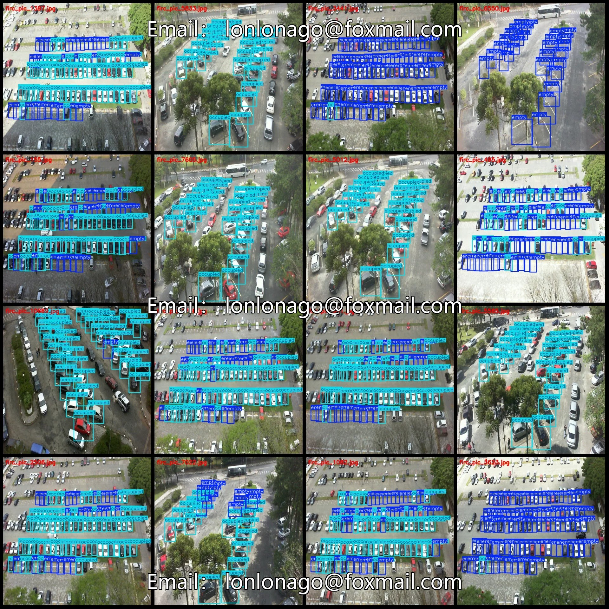
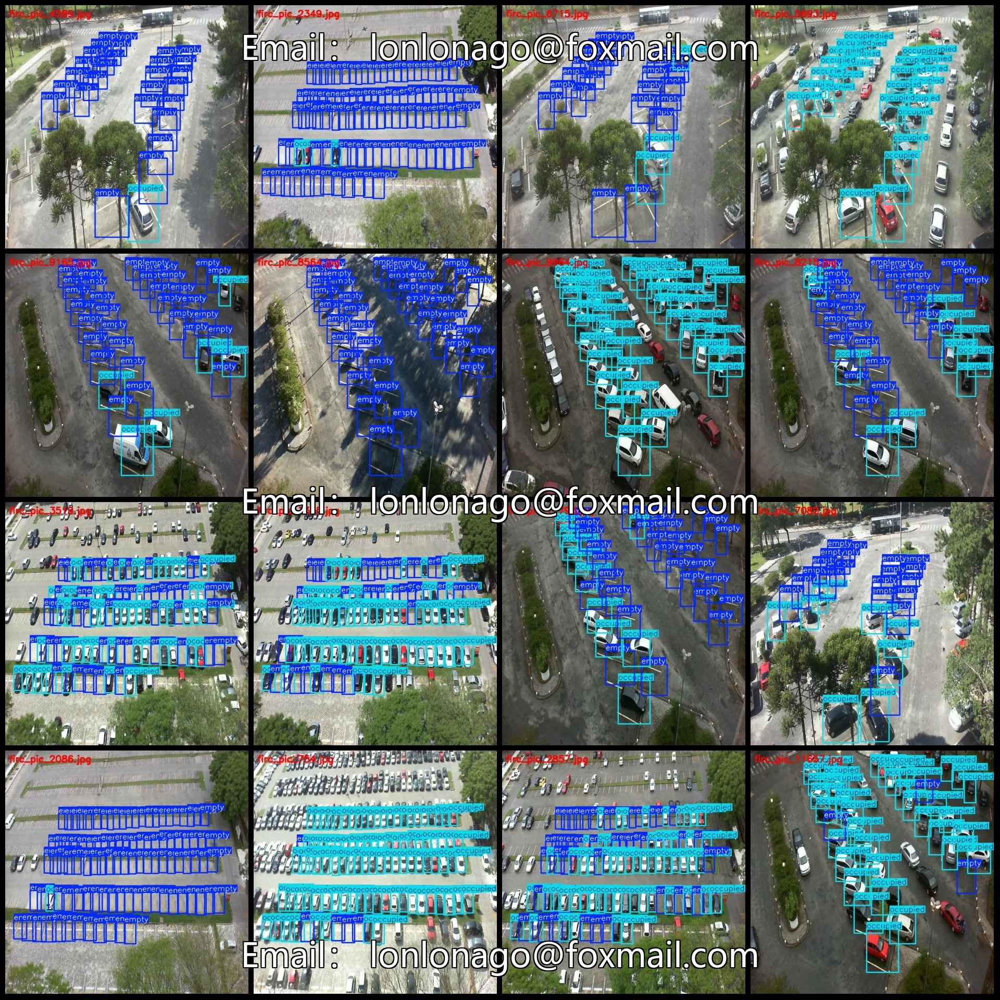
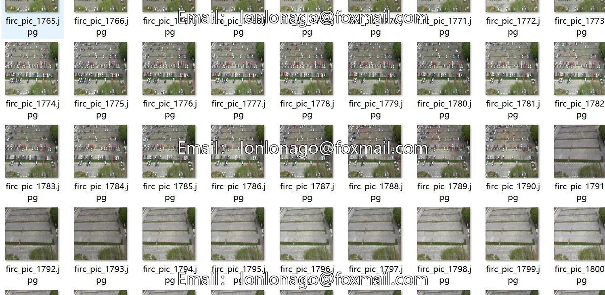
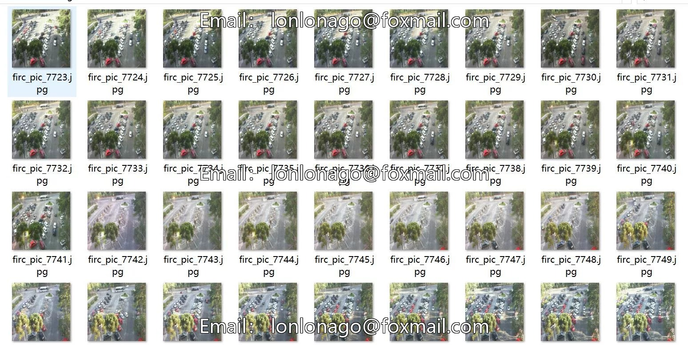
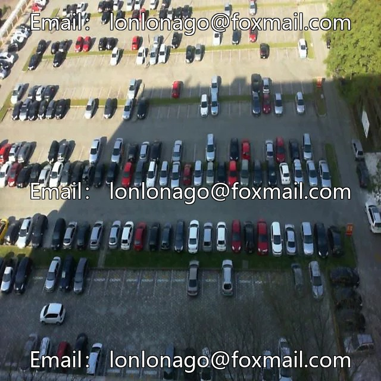
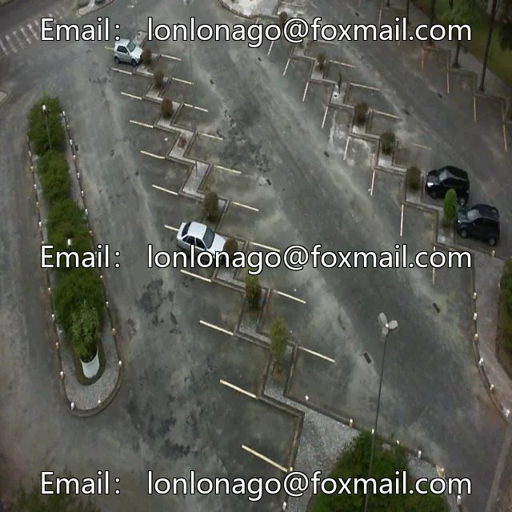
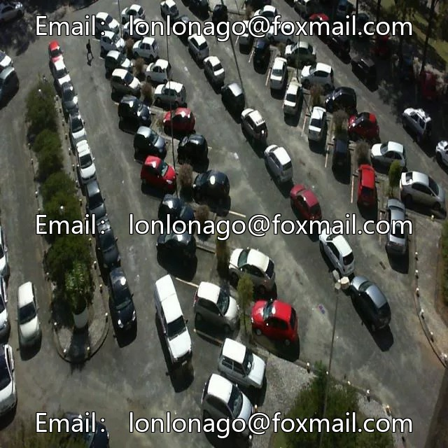

# Drone-view parking lot with empty and occupied parking spaces detection dataset VOC+YOLO

## Body

Drone Perspective Parking Lot Occupancy Detection Dataset - VOC+YOLO Format: 12,142 images in 2 categories
Warm Reminder: Due to the dataset's replicability, please confirm compliance with requirements before purchasing.
Please note that the dataset contains approximately 4 scenes, and each image represents the parking lot occupancy at different times within a scene. Therefore, there are many repetitive images (though not identical), which you should carefully review upon purchase. After purchasing, you acknowledge the dataset.
After sale, under the circumstances mentioned, refund requests for insufficient scene diversity or excessive repetition will be unacceptable.

Dataset format: Pascal VOC format + YOLO format (txt file without split path, only containing jpg images and corresponding VOC format xml files and yolo format txt files)
Number of images (number of jpg files): 12142
Number of annotations (number of xml files): 12142
Number of annotations (number of txt files): 12142
Number of annotation categories: 2
Annotation category names (note that the order of categories in the yolo format does not correspond to this, but refer to the labels folder's classes.txt): ["empty", "occupied"]
Number of boxes per category
Empty (free) box count = 376121

Occupied (occupied) Frames = 335735
Total Frames: 711856
Number of Pictures per Category Occupied
Empty (empty) Pictures = 10468
Occupied Pictures = 9718
Image Resolution: 640x640
Labeling Tool: labelImg
Labeling Rules: Draw a rectangle around the category.
Important Note: The dataset does not have splits for training, validation, or testing; you need to manually divide it.
Special Remark: This dataset does not guarantee the accuracy of the trained models or weight files.

## Images

## Payment

Here is a pay link on Stripe ( https://buy.stripe.com/3cs8yP7sY87d0vu9AB ). Please contact me lonlonago@foxmail.com after funding $89, and I will send you a complete data files , thank you!

